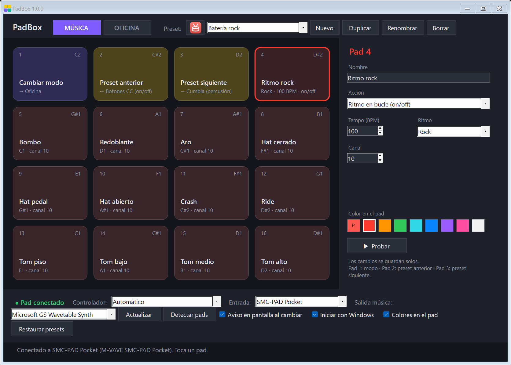

# PadBox

**Convierte cualquier controlador MIDI de pads en un instrumento y en un panel de atajos para Windows.**

PadBox tiene dos modos que cambias con el pad 1:

- **🎵 Música:** baterías, cumbia, cumbia villera, acordeón, saxofón, dubstep, blues y más. Cada preset tiene su propio ritmo en bucle, instrumento, tonalidad y batería. También puedes cargar tus propios sonidos (mp3, wav…) y tocar bucles sincronizados estilo *drum pad*.
- **💼 Oficina:** atajos para Windows, el navegador, OBS, Photoshop, Illustrator y Word/Excel. Por ejemplo: copiar y pegar, controles de música, volumen, escenas de OBS y herramientas.

Los pads 2 y 3 pasan al preset anterior y al siguiente. Al cambiar, aparece un aviso pequeño con el ícono y el nombre del preset.



## Descargar

1. Descarga **PadBox-1.0.0.zip** desde la página de descarga o desde *Releases*.
2. Descomprímelo en una carpeta (por ejemplo, en Documentos).
3. Conecta tu controlador por USB y abre **PadBox.exe**.

No necesita instalación ni conexión a internet. Funciona en **Windows 10 y 11**, que ya traen .NET Framework 4.8.

> **«Windows protegió tu PC»**: como PadBox todavía no tiene firma digital, Windows puede mostrar ese aviso la primera vez. Pulsa **Más información → Ejecutar de todas formas**. Algunos antivirus también desconfían de los programas que simulan teclas, que es lo que hace el modo Oficina para enviar atajos. El código está completo en este repositorio para que cualquiera lo revise.

## Controladores compatibles

PadBox reconoce el controlador por el nombre de su puerto MIDI. Si tu modelo no está en la lista, elige «Otro controlador (8 o 16 pads)». Con **Detectar pads**, PadBox aprende qué nota manda cada pad: lo tocas y listo.

| Controlador | Pads | Colores en los pads | Estado |
|---|---|---|---|
| M-VAVE SMC-PAD Pocket | 16 | ✅ RGB por pad | ✅ Probado |
| M-VAVE SMC-PAD | 16 | — | Sin probar |
| M-VAVE SMK-25 / SMK-37 | 8 | — | Sin probar |
| Akai MPD218 / MPD226 / MPD232 | 16 | — | Sin probar |
| Akai LPD8, MPK Mini | 8 | — | Sin probar |
| Novation Launchpad X, Mini MK3, Pro MK3 | 16 (bloque de 4×4) | ✅ RGB por pad | Sin probar |
| Cualquier otro controlador MIDI | 8 o 16 | — | Con «Detectar pads» |

*«Sin probar»* significa que el perfil se armó con la documentación del fabricante, pero no se ha probado con el aparato real. Si tienes uno de esos modelos y algo no funciona, abre un *issue*.

## Cómo se usa

- **Editar un pad:** haz clic en él en la pantalla. Puede ser un atajo de teclado (con el botón «Grabar»), texto, abrir un programa o una web, nota, acorde, melodía paso a paso, ritmo en bucle, sonido, CC o Program Change. También eliges su color en el aparato.
- **Cargar sonidos:** arrastra archivos de audio desde el Explorador y suéltalos sobre un pad. Se copian a la carpeta `Sonidos`, junto a PadBox.exe.
- **Usarlo con otros programas de música:** instala [loopMIDI](https://www.tobias-erichsen.de/software/loopmidi.html), crea un puerto, elígelo en «Salida música» y actívalo como entrada en tu DAW.
- **OBS:** el preset OBS usa las teclas F13 a F24, que no existen en el teclado y por eso no chocan con nada. En OBS, ve a *Configuración → Atajos*, haz clic en una acción y toca el pad.
- **En segundo plano:** al cerrar la ventana, PadBox sigue funcionando junto al reloj. Para salir del todo: clic derecho en el icono → Salir.

## Compilar desde el código

No hace falta instalar Visual Studio: basta el compilador de C# que trae Windows.

```bat
build.bat
```

Esto genera `dist\PadBox-1.0.0\` y `dist\PadBox-1.0.0.zip`. El script también ejecuta `GenSonidos`, que **sintetiza desde cero** los sonidos del preset «Drum Pad EDM» (no usa sonidos de terceros).

## Créditos

- El control de los colores del **SMC-PAD Pocket** se basa en la documentación del protocolo de configuración de M-VAVE del proyecto [DiscoFloor](https://github.com/krisvandecruys/DiscoFloor) (licencia MIT). PadBox solo cambia los colores en la memoria temporal del aparato y los devuelve al cerrar; nunca guarda nada de forma permanente.
- Los colores del **Launchpad** usan el protocolo público de Novation (*Programmer's Reference*).
- Los ritmos, presets y sonidos del pack EDM son originales de PadBox.

PadBox no incluye canciones ni melodías de terceros. Si cargas tus propios sonidos, asegúrate de tener derecho a usarlos.

PadBox no está afiliado a M-VAVE, Akai, Novation, OBS, Adobe ni Microsoft. Sus marcas pertenecen a sus dueños. Más detalles en [AVISOS.txt](AVISOS.txt).

## Licencia

[MIT](LICENSE). Los sonidos generados por `GenSonidos` se pueden usar libremente.

---

### English (short)

**PadBox** turns any MIDI pad controller into an instrument and a Windows shortcut panel. It includes music presets with looped rhythms, custom sounds (mp3/wav), synced drum-pad loops, and office presets for Windows, browsers, OBS, Photoshop, Illustrator and Word/Excel. Pad 1 switches modes, and pads 2 and 3 switch presets. It is tested on the M-VAVE SMC-PAD Pocket (with RGB pad colors); profiles for Akai, other M-VAVE models and Novation Launchpad are untested, and any controller works with "Detect pads". It is portable, needs no install, and runs on Windows 10/11. Build it with `build.bat`. Licensed under MIT.
